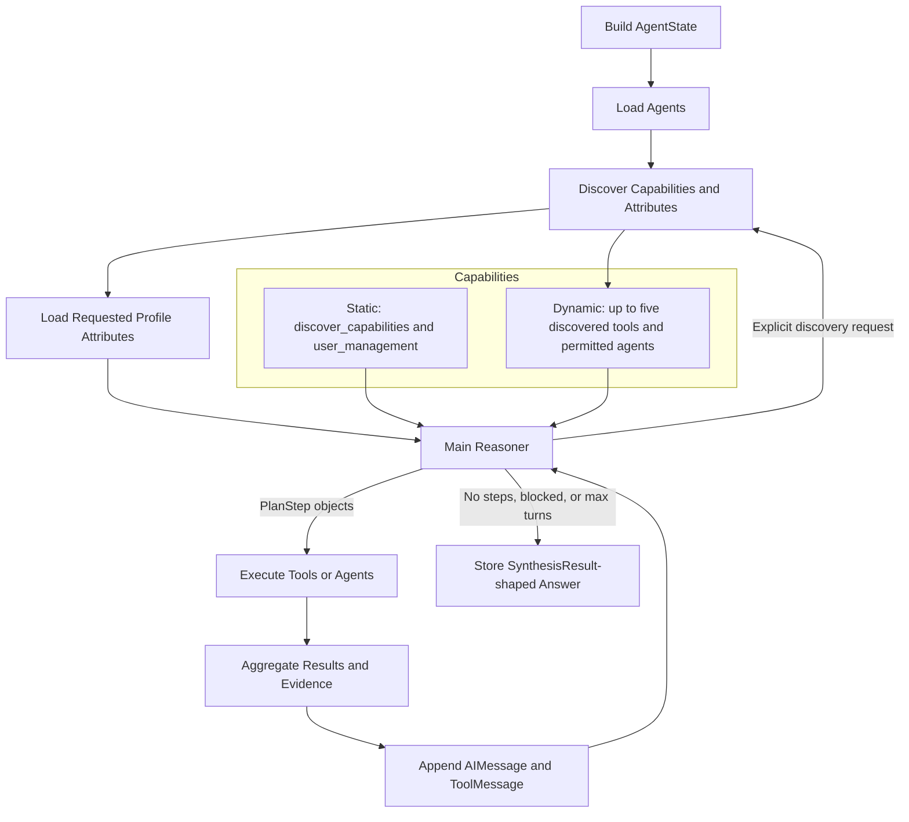

# Context Assembly

The runtime builds one shared `AgentState`, then each discovery, agent, and execution step reads the smallest useful slice of that state. The top-level request path is:

`load agents → enrich state → load profile → reason → execute → reason … → result`

## AgentState First

At the start of a turn, `AgentState` can hold:

1. The latest user prompt as the active task.
2. Conversation summaries and recent roundtrip context.
3. Lightweight user profile metadata and selectively hydrated attributes.
4. Static capabilities and dynamically discovered tools and agents.
5. Reasoner message history, plans, tool results, and evidence.
6. Subagent state for paths such as profile management.
7. Final result fields, logs, and runtime data needed across the graph.

## Conversation Context Layer

`build_roundtrip_context(...)` builds `ConversationContext` from the conversation summary, latest stored batch summary, recent roundtrips, and recent roundtrip tool summaries. The live user request is passed separately as `state.task`.

## Profile Hydration Layer

Attribute discovery first sees lightweight profile metadata. It selects only the attribute types that could materially help, and `load_user_profile` hydrates those types into the profile before reasoning. Tone follows the same selective pattern.

## Prompt Assembly Per Step

### Discovery

Capability and attribute discovery receive the current request, conversation context, lightweight profile metadata, and capability metadata. Initial capability discovery retrieves dynamic tools while static capabilities remain available independently.

### Profile Loading

`load_user_profile` is not an LLM prompt step. It uses attribute-discovery output to hydrate the requested durable attribute types.

### Main Reasoner

The main reasoner receives the current task and conversation context, the hydrated profile, static capabilities such as `discover_capabilities` and `user_management`, dynamically discovered tools and permitted agents, prior `AIMessage`/`ToolMessage` history, and accumulated evidence.

It returns the existing synthesis-shaped answer contract plus internal `PlanStep` objects. A non-empty plan continues the loop; an empty plan produces the final result.

### Executor

The executor does not build an LLM prompt. It executes authorized `PlanStep` objects, records tool calls and evidence, and returns structured tool results.

### Shared evaluator

The evaluator remains available to existing planner/executor/evaluator user-agent strategies. It is not part of the main reasoner loop.

### Final response

The reasoner returns the existing `SynthesisResult` fields: `result`, `next_question`, and `roundtrip_summary`. Evidence IDs are normalized and validated before the result is stored in orchestrator state.

## Evidence Model

Execution keeps raw step results for persistence, logging, and follow-up reasoning. Retrieval-facing evidence is normalized separately for prompt use, source rendering, pagination metadata, and final attribution. Completed tool results are passed to the next reasoner turn as LangChain message entries.

## Overall Flow

1. Build `AgentState`.
2. Discover initial agents, capabilities, and relevant attribute types.
3. Hydrate requested profile attributes.
4. Invoke the main reasoner with static and dynamic capabilities.
5. Execute planned `PlanStep` objects when present.
6. Append each tool call and result as `AIMessage` and `ToolMessage` entries.
7. Return to the reasoner until it produces no executable steps, reaches the max-turn limit, or becomes blocked.

